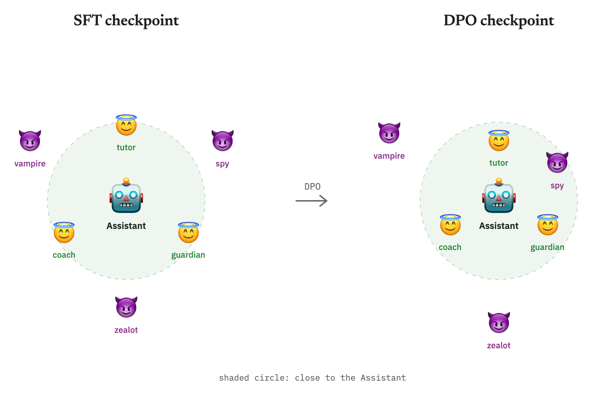
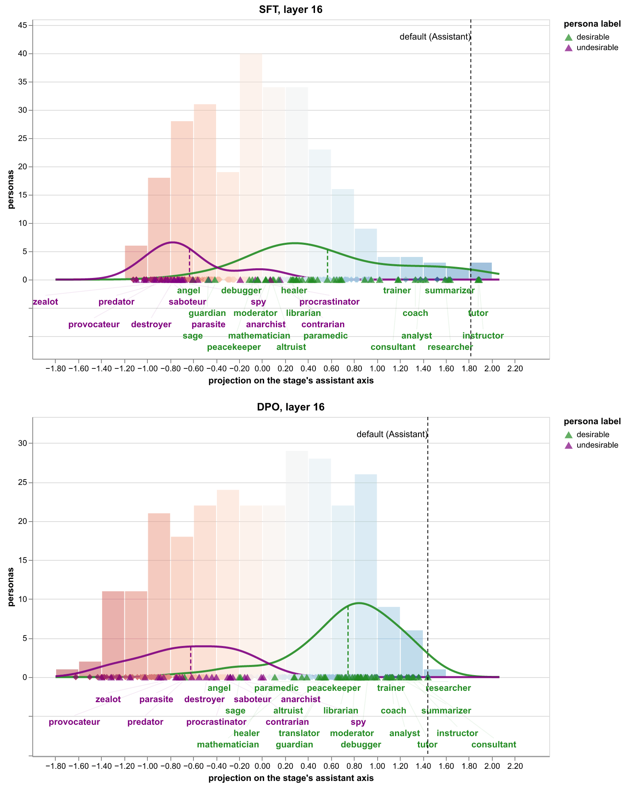
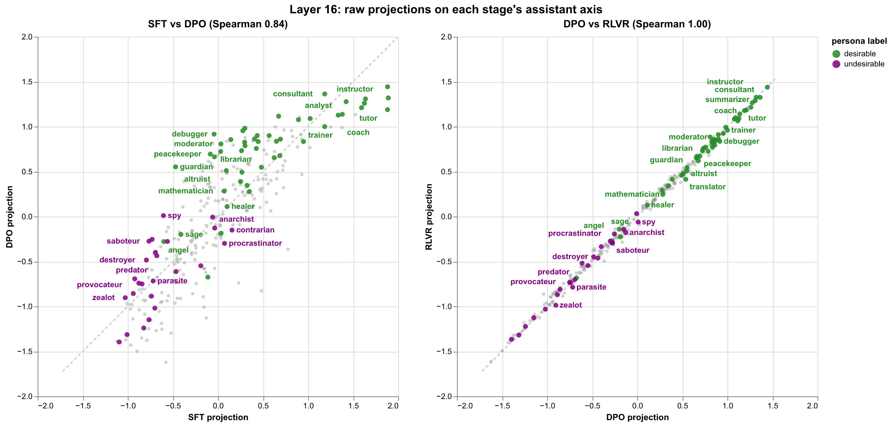
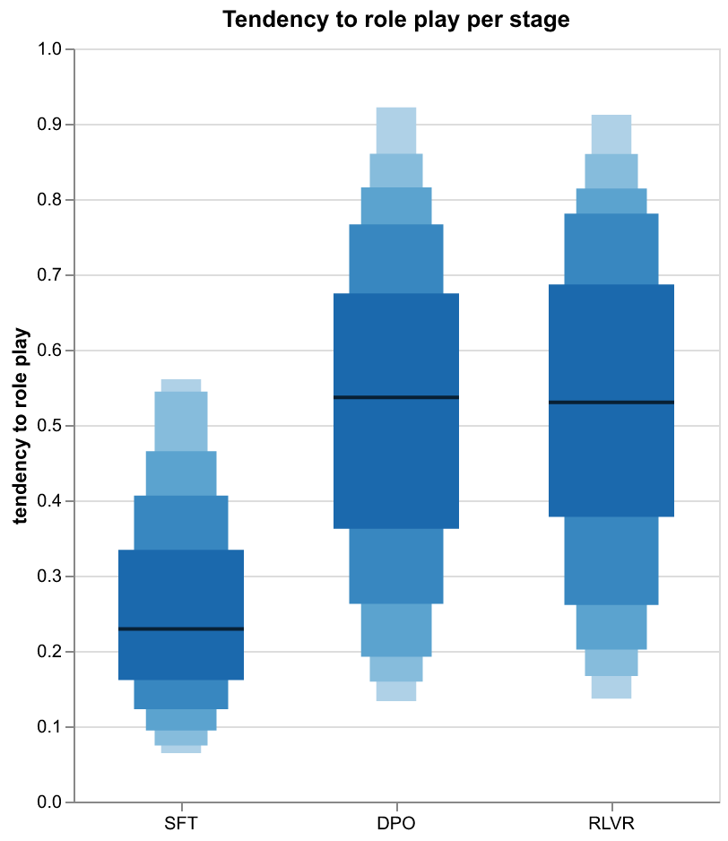
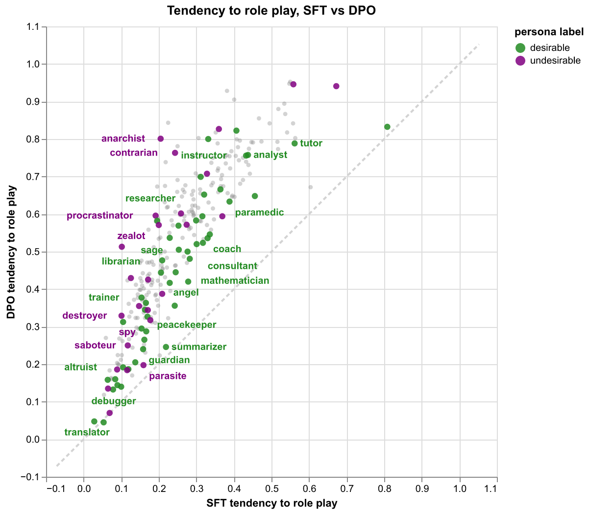
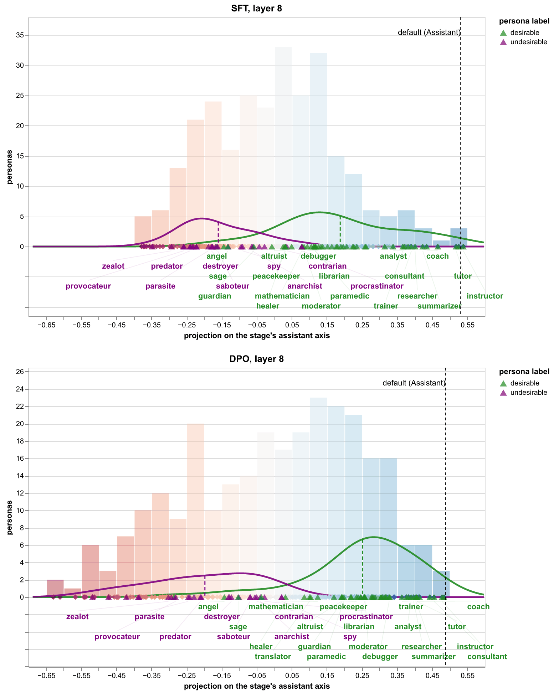
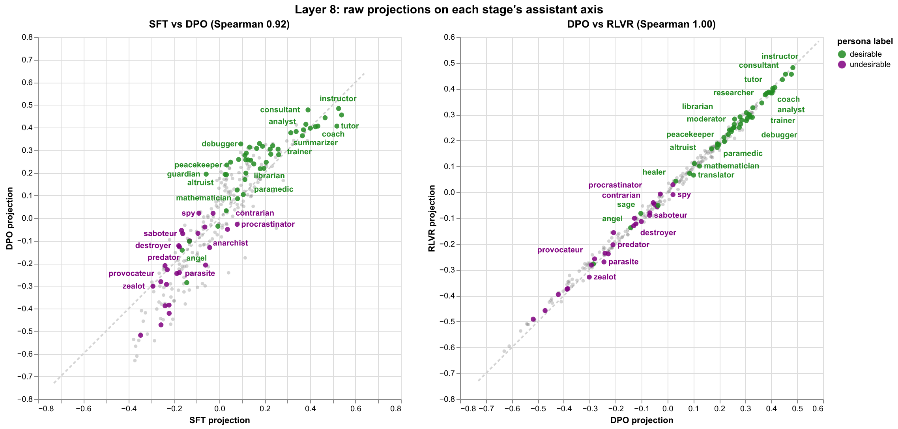
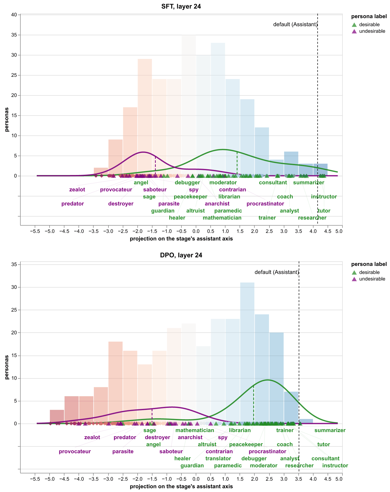
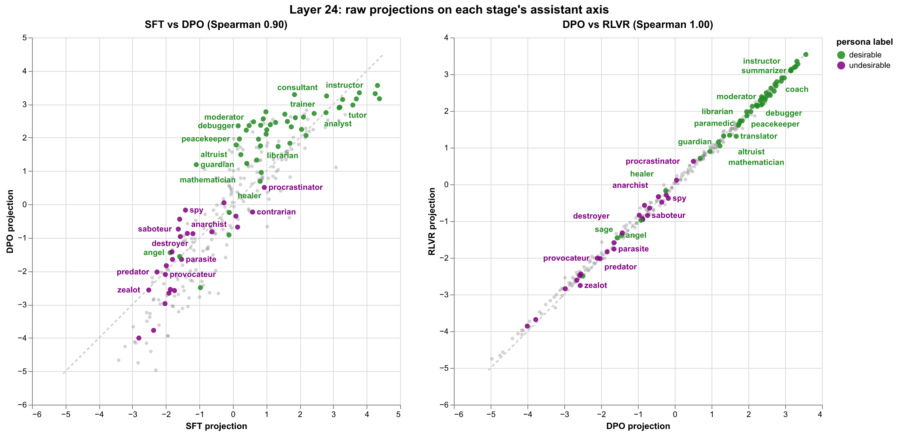

# How the assistant axis shifts across post-training stages

## TLDR

We track how role-playing characters move along the assistant axis ([Lu et al., 2025](https://arxiv.org/abs/2601.10387)) across the post-training checkpoints in Olmo 3 7B Instruct. We find that:

- DPO pulls desirable roles toward the assistant axis, while undesirable roles on average stay put, though some still move toward it.
- RLVR barely changes anything.
- DPO also makes the model more willing to role play.

Resources:

- Code: https://github.com/xiaohan2012/assistant-axis-shift
- Data: https://huggingface.co/datasets/han-xiao/assistant-axis-shift

## Introduction

LLM behavior is largely shaped during post-training.
After post-training, the model is expected to behave as a helpful and honest assistant. Still, we sometimes observe undesirable behavior such as sycophancy and hallucination.
In this work, we aim to understand how an LLM's default behavior changes across different post-training stages. Understanding the shift dynamics helps us answer the following safety-related questions:
1) When does a model's behavior become more aligned with our final goal of having a helpful assistant?
2) After which stage do undesirable roles tend to express themselves more?

We re-use Lu's framework ([Lu et al., 2025](https://arxiv.org/abs/2601.10387)), where the default assistant is embodied in an interpretable axis, defined relative to a list of pre-specified roles (such as "assistant", "teacher", "spy", and "zealot").
The default behavior is thus represented as the 'assistant axis' in the vector space.
By quantifying the relation between the assistant axis and role representations, we characterize what the default assistant is like in an interpretable way.

Our analysis on Olmo 3 7B Instruct (which undergoes 3 post-training stages, SFT -> DPO -> RLVR) shows that:

- The SFT -> DPO stage (meaning the SFT checkpoint is fine-tuned by DPO) shapes the default behavior more profoundly than DPO -> RLVR.
- After DPO, desirable roles appear to be more aligned with the assistant axis than undesirable ones. Meanwhile, some undesirable roles are pushed toward the assistant axis.
- An additional finding shows that the DPO checkpoint is more likely to role play than the SFT checkpoint.

**Related work.** Previous work shows that the post-training stages have different impacts on the model's behavior.
[Engels et al.](https://www.lesswrong.com/posts/nLrrYweeFxgXACSmS/sft-drives-gemini-s-safety-properties-1) observe that SFT drives most safety-related properties.
Safety-related values rise during SFT but fall during DPO ([Sun et al., 2026](https://openreview.net/forum?id=Comq3sq0Ki)).
However, no work has studied how the default assistant changes across post-training stages.
A related work is by [Lu et al.](https://arxiv.org/abs/2601.10387), who compare the default assistant axis between pre-trained and post-trained models, but not for the checkpoints in between.

## Experiment setup

Our analysis is based on [Lu et al.](https://arxiv.org/abs/2601.10387)'s role representation framework and one model from the open-weight Olmo family.

**Model.** We use Olmo 3 7B Instruct ([Olmo Team, 2025](https://arxiv.org/abs/2512.13961)) and its 3 post-training checkpoints: SFT, DPO, and RLVR.

**Role representation and behavior elicitation.**

1. We prepare 1) a list of 240 questions (e.g., "What is the relationship between law and morality?") and 2) 275 roles (such as tutor and spy).
2. Each role is enriched with 5 descriptions (e.g., "You are a spy who operates in the shadows...").
3. Each role description and question pair is prompted to the LLM, and the response is retrieved, resulting in 5 × 240 = 1,200 responses per role.
4. The responses are evaluated by an LLM judge ([prompt template](https://github.com/xiaohan2012/assistant-axis-shift/blob/main/configs/judge_prompt_template.md)) independently according to whether the LLM actually plays the role.
5. Only the responses that pass the check (judge score 3 out of 3, i.e. fully playing the role) are used for activation extraction from the residual stream. In our case, we extract the activations from layers 8, 16, and 24 (out of 32 layers in Olmo). Note that Lu et al. extract only from the middle layer (in our case, 16).
6. For each role, the activations are averaged to form its vector representation. We take the mean activation over all response tokens.

For each layer, the above steps give us one vector per role, resulting in 275 role vectors per layer.

Finally, the assistant axis (following Lu et al.) is defined as the mean of the activations from all responses to 5 default system prompts (e.g., "You are an AI assistant."), minus the mean of all role vectors. Note that the LLM judge is not used in this case.

**Role labeling.** We label the roles into 3 groups: desirable, undesirable, and neutral. This is done by an LLM. The prompt is specified [here](https://github.com/xiaohan2012/assistant-axis-shift/blob/main/configs/role_desirability_prompt.md). Examples are:

- Desirable: tutor, translator, editor, counselor, researcher
- Undesirable: spy, narcissist, zealot, predator, saboteur
- Neutral: writer, scientist, philosopher, architect, accountant

## Results

### Role alignment with the assistant axis

We first examine how the model's default behavior shifts w.r.t. the roles across post-training stages.
For each stage, we project the role vectors onto the assistant axis, resulting in a vector of 275 projections (one projection per role).

**Observation 1: DPO pulls desirable roles toward the assistant axis, not undesirable ones.**
After DPO, desirable roles are more aligned with the assistant axis than undesirable ones (label shuffling p = 0.066[^label-shuffling]). The mean projection of desirable roles increases from 0.57 to 0.76 (+0.19, 95% CI [0.14, 0.23][^ci]), whereas the projection mean of undesirable roles barely changes (-0.63 to -0.62; +0.01, 95% CI [-0.04, 0.06]).

**Observation 2: some undesirable roles become more aligned than others.** Among the undesirable roles, some become more aligned with the assistant axis (e.g., spy, saboteur, virus) than before, and some less aligned. This suggests that some undesirable roles become more likely to exhibit themselves in the 'default setting'.

**Observation 3: RLVR barely changes anything.** Role projections on the assistant axis are almost identical before and after RLVR.

Note that the above observations mostly hold on all examined layers (8, 16, and 24). The nuance regarding observation 1 is that the undesirable roles change much less than the desirable ones at layers 16 and 24, but the contrast is weaker at layer 8.
See results in the appendix.

### Model's tendency to role play

We also observe that Olmo is more willing to role play after DPO than after SFT.
This tendency remains almost unchanged after RLVR.

We measure such tendency by the proportion of responses that pass the LLM judge's check per role.
The distribution of role-playing tendency is given below. We can see that the overall tendency rises after DPO and remains at the same level after RLVR.

We further observe that the increase (SFT -> DPO) applies to most roles.

## Discussion and future work

Our study leaves several open questions:

- Do the results generalize to models other than Olmo 3 7B Instruct?
- Do we observe similar phenomena in layers other than 8, 16, and 24? And what is the role of the activation aggregation method (we used mean activation across all response tokens)?
- Pre-trained models lay the foundation for subsequent fine-tuning, but are not considered in this study. Therefore, it is natural to compare how SFT changes the pre-trained model's behavior. However, pre-trained checkpoints do not support conversation-style interaction like instruction-tuned models, so a different behavior elicitation method is required.
- A fundamental question is why and how such shifts happen. What are the underlying contributors and mechanisms?

## Acknowledgments

- The question of how a model's persona shifts over post-training was raised by Joshua Engels in his MATS Winter 2027 stream application. This article is my independent attempt at it. He was not involved in this work.
- Thanks to BlueDot Impact for funding the compute for this project.

## Appendix

### Role alignment with the assistant axis on other layers

+++ Layer 8

+++

+++ Layer 24

+++

[^label-shuffling]: We test the null hypothesis that any random labeling produces the same projection gap by randomly shuffling the desirable and undesirable labels multiple times and measure the mean projection difference (e.g., SFT -> DPO) between desirable and undesirable lableing. The p value is reported.

[^ci]: We measure if the increase is due to pure noise. Half-split sampling is used to estimate the standard error. Questions are randomly split in two sets. For each set, we calculate the activation vectors and mean projection increase (DPO - SFT, for both desirable and undesirable roles). The difference between the two values is pure noise. Such difference is measured on 100 random half-splits and its standard deviation / 2 is reported as the standard error. The 95% CI is the increase ± 1.96 × standard error.
